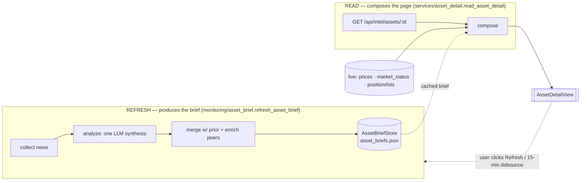
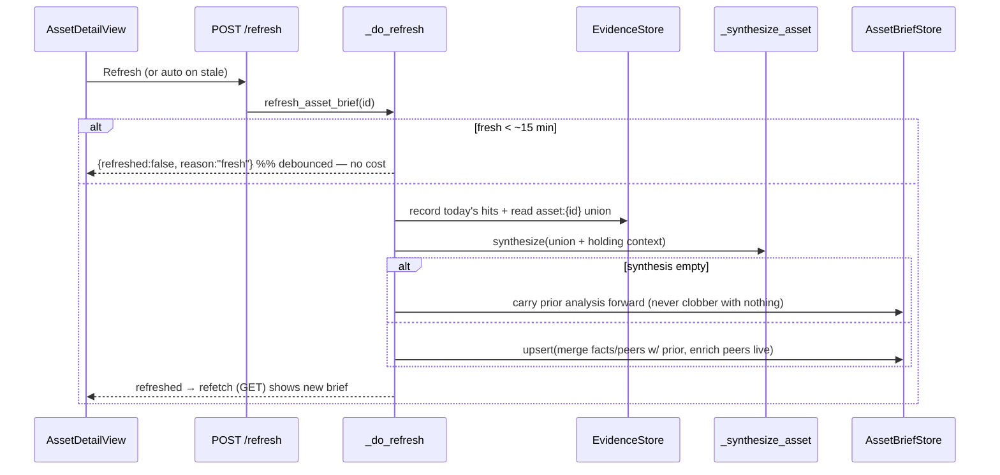

# Asset-detail page — how we collect, analyze & generate its data

Companion to `intel-scans.md` (the evidence cache) + ADR `docs/adr/0005`. The asset-detail page has
**two paths**: a fast **READ** that composes the page from cached + live data (no search/LLM), and a
debounced **REFRESH** that *produces* the cached brief (collect → analyze → merge → store).

## 1. Two paths: produce (refresh) vs compose (read)

The **READ never calls search or the LLM** — it returns the last cached brief + freshly-computed
prices/position, so the page is instant. The **REFRESH** is where collection + analysis happen; it's
debounced (~15 min) and also runs as part of the portfolio's intel scan.

## 2. The REFRESH pipeline — collect → analyze → generate

```mermaid
flowchart TD
  Q["_asset_query(instrument)"] --> FN["_fetch_news_items — ALL enabled search providers<br/>(news verticals + Perplexity answer)"]
  FN -->|record_evidence subjects=asset:&#123;id&#125;| EV[(EvidenceStore — evidence.json<br/>dedup by canonical URL · source/via/guid)]
  RSS["intel scan gather_rss<br/>(Google News local+EN, Yahoo) tags asset:&#123;id&#125;"] -->|record_evidence| EV
  EV -->|read_evidence asset:&#123;id&#125; fresh UNION| MERGEN["today's hits + still-valid prior<br/>(news no longer vanishes)"]
  MERGEN --> FT["_fetch_full_text (snippet enrich, synthesis-only)"]
  FT --> SYN["_synthesize_asset — ONE LLM call →<br/>description · facts · peers(names) · key_issues(bull/bear) · news_summaries"]
  SYN --> MERGE["MERGE w/ prior brief (non-regression):<br/>_merge_facts (prior fills nulls) · _merge_peers (union + seen_count)"]
  MERGE --> ENR["_enrich_peers — resolve name→ticker (CACHED, skips search) + LIVE price"]
  ENR --> HASH["_content_hash gate (bump synthesized_at only on real change)"]
  HASH --> STORE[(AssetBriefStore.upsert_brief)]
```

Key points:
- **Collect** = the asset's own multi-provider search **unioned with the shared evidence cache** for
  `asset:{id}` — which the **intel scan's RSS** also writes to (local+English Google News + Yahoo).
  So RSS and search both feed asset-detail news, deduped; a still-valid article persists across runs.
- **Analyze** = a **single** LLM synthesis produces description + facts + peer *names* + key_issues +
  news_summaries together (no separate call per field — facts/peers text are ~free).
- **Generate/merge** = facts/peers **build up** instead of being overwritten (a thin run can't blank a
  known CEO or drop a peer); peer **resolution is cached** so `search_symbol` isn't re-run every
  refresh; peer **prices are always live**.

## 3. Where each surface on the page gets its data

| Page surface | Source | Path | Freshness |
|---|---|---|---|
| Name / ticker / exchange / country | InstrumentStore + brief `facts` | read | static + cached |
| **Price · change% · "As of"** | `prices.fetch_live` | read | **live** |
| **Market-status chip** (Open/After hours/Closed) | `prices.market_status` (v7 quote + freshness gate) | read | live, ~cached 10m |
| **Chart + Quote stats** | `asset_detail.price_series` / live quote | read | live (cached per tf) |
| **Stories & Analysis (news)** | brief `news` ← EvidenceStore `asset:{id}` union (RSS + search) | refresh produces, read shows | accumulates; retained ≤90d by **publish date** (ADR 0006) |
| **Key Issues (bull/bear)** | brief `key_issues` (LLM synthesis, cited) | refresh | cached |
| **Key Facts** | brief `facts` (LLM, **non-regression merge**) | refresh | cached, builds up |
| **Peers** (names + exchange) | brief `peers` (LLM names, **cached** resolved ticker) | refresh | cached, builds up |
| Peer **prices / day-change** | `fetch_live` on resolved peer tickers | refresh | live at refresh |
| **Your Position** (qty, cost, P&L) | positions_service + LotStore (money math) | read | live (recomputed) |
| **Price Alerts** card | watchlist item `price_alerts` (+ `item_id`) | read | live |
| **Analyst consensus** (Analysis tab) | Yahoo analyst estimates (own endpoint) | separate fetch | live, self-hiding |
| "Lucius's take" (portfolio_impact) | brief `portfolio_impact` (LLM) | refresh | cached |
| **Notable Price Movement** (per-session timeline) | `services.price_movements` (bars + live quote + `price_movement_notes`) — paragraph by `monitoring.price_movements` (LLM, cited from `evidence`) | own endpoint `GET …/movements`, 60 s poll while open | numbers live; paragraph once per close (+ throttled live re-narration on demand) |

## 4. Refresh sequence (debounce + non-clobber)

See `backend/services/asset_detail.py` (read/compose), `backend/monitoring/asset_brief.py`
(refresh/collect/analyze/merge), `backend/services/feeds.py` + `backend/monitoring/collect.py` (RSS),
and `intel-scans.md` for the shared evidence cache.
