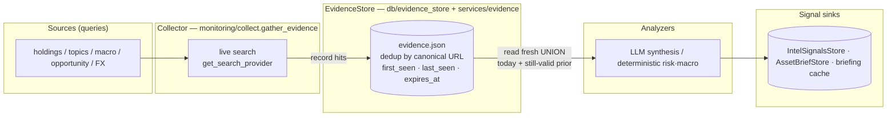
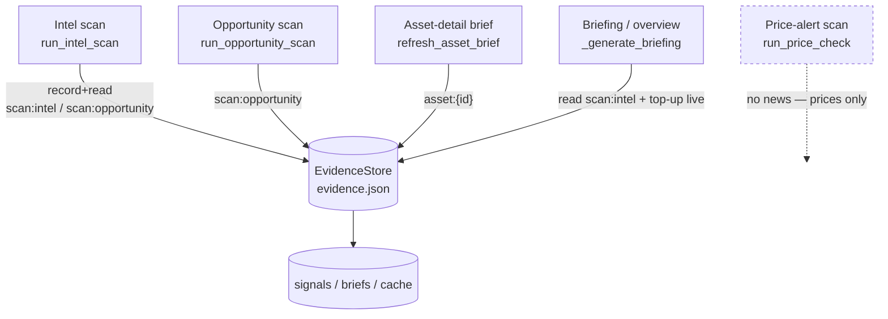
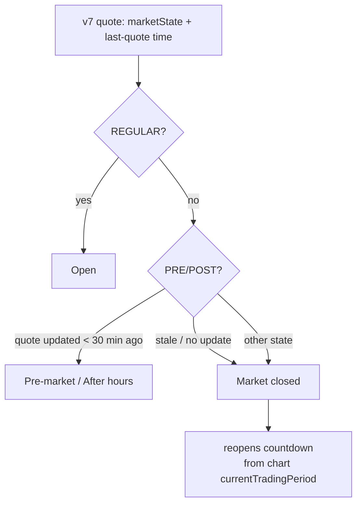
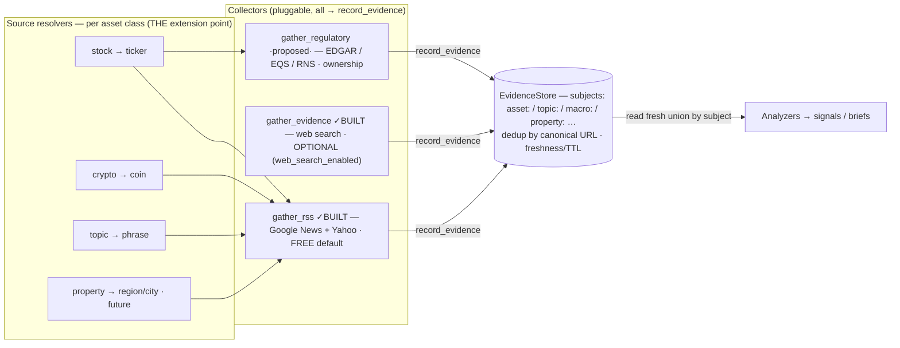
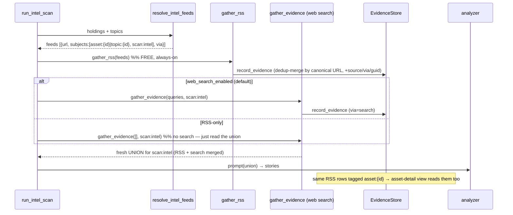
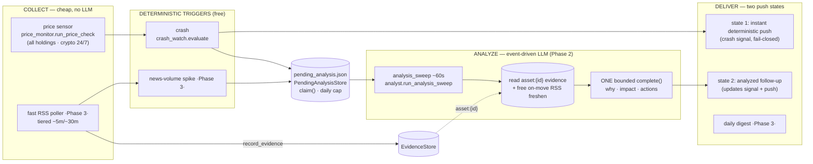
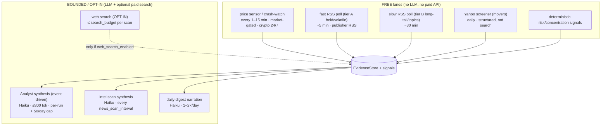

# Intel scans & the evidence cache — how it works now

Visual companion to RFC `.claude/rfcs/intel-scan-architecture.md` and ADR `docs/adr/0005`.
All five Intel "scans" now compose from one pipeline and read/write **one durable evidence cache**,
so a still-valid article can't vanish just because it dropped out of a single live search — while the
latest news is never delayed (every scan still live-searches; the cache only *supplements*).

## 1. The pipeline (the lego pieces)



The collector's contract is the whole fix: it **records** today's live hits into the store, then
**returns the union** of those hits with prior unexpired rows for the same `subjects` — so the
analyzer sees today's new articles **plus** yesterday's still-valid ones.

## 2. How the five scans compose



| Scan | Subjects | Kind / TTL | Reads union? | Writes cache? |
|---|---|---|---|---|
| Intel scan | `scan:intel`, `scan:opportunity` | news **publish+90d** · opp 12h | yes | yes (+ prunes expired) |
| Opportunity scan | `scan:opportunity` | opp 12h (scan-time) | yes | yes |
| Asset-detail brief | `asset:{id}` | asset **publish+90d** | yes (appends prior) | yes |
| Briefing / overview | `scan:intel` | news **publish+90d** | yes | yes (always live-searches — top-up) |
| Price / crash scan | — | — | n/a (prices, not news) | no — but **enqueues analysis events** (§6) |

**Retention is PUBLISH-based for news/asset (ADR 0006).** A `news`/`asset` row expires at
`published_at + 90 days` — keyed to the **article's own age**, not when we last scanned it. So a
still-recent article never drops just because no scan re-surfaced it, and a day of paused
monitoring/downtime can't wipe the cache (the old `collected + 24h` rule did both). `opportunity`
(12 h) and `macro` (48 h) stay scan-time TTLs — they're time-sensitive scan context, not durable
articles. Undated rows fall back to `first_seen + 90d`; the parser tolerates ISO + RFC-2822 and
rejects garbage/far-future dates. See `services/evidence._compute_expires`.

## 3. The accumulation guarantee (the "news doesn't disappear" fix)

```mermaid
sequenceDiagram
  participant Scan
  participant Collector as gather_evidence
  participant Provider as live search
  participant Store as EvidenceStore

  Note over Store: Day 1 — article A recorded (first_seen=D1, expires = A.published_at + 90d)

  Scan->>Collector: gather_evidence(queries, subjects)
  Collector->>Provider: search(queries)  %% always runs — latest is never delayed
  Provider-->>Collector: [B]  (A dropped out of today's results)
  Collector->>Store: record_evidence([B])  %% B inserted; A untouched, still fresh
  Collector->>Store: read_evidence(subjects, fresh_only)
  Store-->>Collector: [A, B]  %% union: A survives because it hasn't expired
  Collector-->>Scan: [A, B] in provider shape
  Note over Scan: analyzer sees A AND B — A did not vanish
```

Dedup + lifecycle on re-surfacing the same URL (canonical id `ev_<sha1(canonical_url)>`):
`first_seen` is preserved (earliest), `last_seen`/`seen_count` advance, and `subjects`/`queries`
are unioned. For news/asset, `expires_at` is **recomputed from `published_at + 90d`** on every record
— stable across re-records (idempotent under the store's `max(expires_at)` merge), so re-surfacing
isn't needed to keep a recent article alive. A row is GC'd only when `now > expires_at` (evergreen
reference domains exempt) — never because one live search omitted it.

## 4. Market status (related: how open/closed is decided)

The asset-detail price chip and the price-alert gate classify a market from the **batched Yahoo v7
quote gated by freshness** — not the raw `marketState` string (which sticks on `POST` overnight).



See ADR `docs/adr/0005` for the evidence decisions and the market-status section of
`backend/services/prices.py` for the freshness gate.

## 5. Multi-source sourcing — RSS (built) · topics · regulatory + new classes (proposed)

> **Status: RSS shipped.** Now BUILT: the **`gather_rss`** collector (Google News + Yahoo per-ticker,
> SSRF-guarded, per-feed 15-min cache, bounded concurrency), the per-class **source resolver**
> (`services/feeds.py` — stock/crypto/topic; a non-US stock is fetched in **both** its **local
> language AND English** — local catches local-outlet/regulatory news, English catches the global
> wires — deduped by canonical URL), wiring into
> `run_intel_scan` (RSS feeds holdings + topics into the same evidence cache), the **`web_search_enabled`**
> toggle (RSS is the free default; paid web search is the optional upgrade), and richer evidence
> provenance (`source`/`via`/`guid`/`author`), the **dedicated fast-lane scheduler** (Phase 3a —
> tiered `rss_poll_fast`/`rss_poll_slow`, see §6–§7), and the **commodity** news query. Still
> **proposed**: the **regulatory** collector (EDGAR/EQS/RNS — authoritative ownership/voting-rights)
> and the **property** resolver. None of those need new core — the EvidenceStore keys on **opaque
> `subjects`** and stores **provider-shaped hits**, so each is just another collector/resolver.

### 5.1 Many sources, one store



A story from RSS and the same story from web search **merge into one evidence row** (same canonical
URL → unioned subjects/queries). Web search becomes the *optional* "comprehensive" layer the user
toggles; RSS keeps the cache populated for free even when it's off.

### 5.2 Topics are first-class (already)

The watchlist already has `type:"topic"` items with crafted `search_queries` (used by the scan's
`topic_queries`). Because Google News RSS is a **query** endpoint, those same queries drive RSS
directly → tagged `subjects=["topic:{id}"]`. No special-casing: to a collector, "a query" is a
query whether it came from a ticker name or a topic phrase. (Optional: Google News *section* feeds
— BUSINESS / TECHNOLOGY — for broad standing topics.)

### 5.3 The resolver — the only per-asset-class code

Everything downstream (collectors, store, analyzers, sinks) is class-agnostic. A new asset class
needs **one** thing: a resolver that turns an entity into `(subject, queries, feeds)`.

| Entity | Subject | Resolver yields | Status |
|---|---|---|---|
| Stock / ETF | `asset:{id}` | Google News **both editions — local (listing locale) + English** + Yahoo per-ticker | ✓ built (`resolve_holding_feeds`) |
| Crypto | `asset:{id}` | Google News (coin name) | ✓ built (`resolve_holding_feeds`) |
| Topic | `topic:{id}` | Google News query from the item's `search_queries` | ✓ built (`resolve_topic_feeds`) |
| + regulator | `asset:{id}` | EDGAR / EQS / RNS by listing country | proposed |
| Macro / FX | `macro:{ccy}` | central-bank feeds (Fed→USD, ECB→EUR…) keyed to **held** currencies | proposed |
| Property | `property:{id}` | Google News "{city} housing market" (locale) + mortgage/rate feeds + regional house-price index | proposed |
| Commodity / bond | `asset:{id}` | Google News + instrument-specific feeds | proposed |

So "extend to properties and other assets" = **add a resolver**, not rewire the pipeline. The
property lane is coarser (region-level, not per-unit) but real: local-market news + the rate feeds
that actually move property values, all landing in the same evidence cache and signal feed.

### 5.4 Cadence & guards

**Built guards** (`monitoring/collect._fetch_feed` / `gather_rss`): SSRF-guarded fetch
(`assert_public_url`), a **per-feed 15-min cache** (don't refetch within the window — honors Yahoo's
`max-age=300`), **bounded concurrency** (politeness to Google News/Yahoo), a real User-Agent, and
per-feed failure isolation (one bad feed never sinks a scan). Feeds are bound to **held + watched**
entities by the resolver. RSS runs inside `run_intel_scan` today (free, always-on).

**Phase 3 (shipped): the fast freshness lane.** A dedicated RSS poller (`rss_poller.run_rss_poll`),
**tiered** (held/volatile fast; long-tail watchlist/topics slow), running **independently of the heavier
LLM scan** — closing the "news too late" gap. It **does no LLM work**: it only fills the evidence cache,
and a **publish-based news-volume-spike** detector (counts `published_at` in a window, ≥ floor AND ≥3×
the asset's own baseline, cold-start-guarded, per-poll capped — see ADR 0006 for the incident that
forced publish-based over fetch-based) enqueues a `news_spike` event (§6) so the Analyst wakes on news
the same way it wakes on a crash. The 12 h `news_scan_interval` is no longer the LLM gate (collection
cadence is split from synthesis cadence). Still proposed beyond Phase 3: resolving Google News redirect
URLs to the publisher for cross-source dedup, and a contact User-Agent for the SEC EDGAR feed.

### 5.5 As-built: the intel-scan data flow with RSS



## 6. The Analyst pipeline — collect → event → analyze → deliver

The Intel **Analyst** (RFC `.claude/rfcs/lucius-wealth-manager-and-analyst.md`) is a separate spine
from the periodic news scan above: it **reacts to events** instead of running the LLM on a fixed clock.
It reuses the same EvidenceStore but adds a **price sensor**, a **pending-analysis event ledger**, and
a **two-state delivery** (instant recall, then analysis).



**Lanes & status:**

| Lane | What | LLM? | Status |
|---|---|---|---|
| Price sensor → crash | `price_monitor._run_crash_lane`: down-move past `CRASH_MOVE_PCT` (equity 12 / commodity 15 / crypto 25; cash/property/bond off) on **any** holding → deterministic signal + instant fail-closed push | no | ✅ Phase 1 (`8f627f31`) |
| Event ledger | `PendingAnalysisStore` (`pending_analysis.json`, CACHE_DIR, checkpoint-excluded): crash enqueues a row; atomic `claim()` makes overlapping sweeps safe; rolling-24 h daily cap | no | ✅ Phase 2 (`8d4fdaa2`) |
| Analysis sweep | `analyst.run_analysis_sweep` (~60 s job): drain → read `asset:{id}` evidence + free on-move RSS freshen → **one bounded `core.llm_seam.complete`** (no agent loop, no paid search), **grounded in the user's position (qty/value/cost/P&L/%NW) + profile (risk tolerance, goals)** so output is specific, not generic, and admits when news is just macro chatter → update/create the signal → fail-closed push (configured channels only, never `in_app`) | yes (bounded, Haiku) | ✅ Phase 2, position-aware (`d596f30d`) |
| Fast RSS poller | `rss_poller.run_rss_poll`: tiered (held/volatile fast, long-tail slow) collector filling the cache, decoupled from the LLM; tier-aware `max_age` cache window | no | ✅ Phase 3a (`feeb0745`) |
| News-volume spike | **publish-based** detector (`published_at` window, ≥ floor AND ≥3× the asset's own baseline, cold-start-guarded, per-poll capped) → enqueues a `news_spike` event → same sweep wakes the Analyst on news, not just price | no (trigger) | ✅ Phase 3a (`feeb0745`) |
| Opportunity discovery | FREE by default: RSS discovery queries (`resolve_opportunity_feeds`) + Yahoo screener (`prices.fetch_movers`); paid web search opt-in; **in-app only** (no push) | yes (synthesis) | ✅ Phase 3b (`3f38a52e`) |
| Daily digest | `digest.run_eod_digest` (daily) + `run_premarket_digest` (conditional); one bounded narration call; single channel-agnostic message + per-day in-app signal; once/day guard via `digest_state.json` | yes (1×/day) | ✅ Phase 3c (`37cc4d91`) |

**Security invariants (Phase 2):** evidence is UNTRUSTED — control-char strip, dash-collapse to block
delimiter-escape, length/count caps, an explicit untrusted-data system guard; push is **fail-closed**
(only the user-configured `notify_routes.news` channels, never `in_app`); errors log `type(exc).__name__` only; LLM cost
is bounded by a per-run `max_tokens` + the rolling-24 h daily cap.

**Why two spines?** The periodic scan (§1–5) is *broad discovery* over `scan:intel`/`scan:opportunity`;
the Analyst (§6) is *reactive depth* over `asset:{id}` triggered by a real event. They share the
EvidenceStore, so the fast RSS poller (Phase 3) feeds both: it keeps `asset:{id}` fresh for the Analyst
**and** `scan:intel` fresh for the digest — one free collector, two consumers.

## 7. How we CONSUME — cadences, what you can configure, and the cost shape



### 7.1 What you can configure (Intel → Monitoring panel)
| Control | Config key | Default | Effect |
|---|---|---|---|
| Price-alert / crash check | `price_check_interval_seconds` | 15 min (1 min min) | crash-watch + alert poll cadence — **free** |
| News freshness | `news_freshness` | `fast` | fast RSS poll: `off` / Balanced 15 m / Fast 5 m |
| News scan interval | `news_scan_interval_seconds` | 4 h | the **heavy** LLM+search scan cadence |
| **Web search (paid)** | `web_search_enabled` | on | the only paid-search lane; off → RSS+screener carry it free |
| **Web search budget** | `search_budget` | 15 | max paid searches per scan |
| Daily digest | `digest_enabled` / `digest_eod_hour` / `digest_premarket_enabled` | on / 17:00 / on | end-of-session + conditional pre-market |
| Advanced — crash % | `crash_thresholds` | eq 12 / cm 15 / cr 25 | per-class crash trigger |
| Advanced — spike | `spike_min_abs` / `spike_factor` | 5 / 3× | news-spike floor + baseline multiple |

All save-on-change via `PATCH /api/watchlist/config` (Lucius `update_monitoring_config` too); the
scheduler hot-reloads cadences/cron via `reschedule()`.

### 7.2 Cost shape (see ADR 0006)
- **Free, always-on:** price/crash poll, the tiered RSS lanes, the Yahoo screener, deterministic risk
  signals, and reading the evidence cache. RSS is the default news source; it runs regardless of the
  web-search toggle.
- **Bounded LLM (Haiku):** the intel-scan synthesis, the event-driven Analyst (capped per-run + 50/day),
  and the 1–2 daily digest narrations. Typically cents/day for a normal portfolio.
- **The one variable lever — paid web search:** `web_search_enabled` × `search_budget` ×
  `news_scan_interval`. Turning it off (RSS + screener carry discovery) drops the system to ~LLM-only
  cost. (Cost is tracked per-source in `ai/cost_tracker`; web-search provider spend is billed
  separately by the provider, not in that ledger.)
